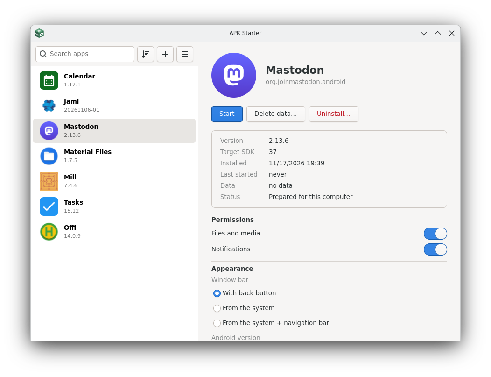

# APK Starter

**Run Android apps on Linux as native windows. No emulator, no container.**

APK Starter runs Android apps (APK files) on the Linux desktop: each app gets its own window, a menu entry and its
own data folder. It is a Flatpak built on
[Android Translation Layer (ATL)](https://gitlab.com/android_translation_layer/android_translation_layer), which
implements Android's app interfaces on Linux; the app code runs in ART, Android's runtime.



**How is it different from Waydroid or Anbox?** Waydroid and Anbox start a complete Android system in a container.
APK Starter does not run an Android system: every app is a normal Linux process with its own window. There is no
Android image and no container or virtual machine; apps that need parts of Android that ATL does not implement yet do
not work.

**Which apps run?** In the test run for 0.9.3, 150 of 151 free apps started and went through a short scripted test
(start, scroll, menu, back) without crashing; one (Amaze) crashed. The full list is on the
[project page](https://jimbambuli.github.io/apk-starter/#tested). Jetpack Compose apps (e.g. Tasks), Flutter apps (e.g. Sanmill, Aves) and Aurora Store are part of the tests. A run
without a crash does not mean that every function of an app works.

**How was it made?** APK Starter is vibe coded: the starter and its fixes in ATL, ART and bionic_translation were
written by an AI coding assistant (Claude by Anthropic) under the direction of the maintainer, and checked with test
runs on real apps.

**Limits:** x86_64 APKs only, no ARM-only apps; camera, Bluetooth and telephony are not supported; no Google Play
Services (use microG).

## Install

```
flatpak install --user https://jimbambuli.github.io/apk-starter/io.github.Jimbambuli.ApkStarter.flatpakref
```

The repository is signed (key: [pages/apk-starter.gpg](pages/apk-starter.gpg)). Flatpak exports only the app ID as a
command, so for a short command on the host add an alias:

```
alias apk-starter='flatpak run --file-forwarding io.github.Jimbambuli.ApkStarter'
```

## Use

Open **APK Starter** from the application menu (or run `apk-starter` without arguments): the installed apps are
listed on the left (search with Ctrl+F or by just typing, sort by name, last start, last install or data size), the
chosen app's details on the right: version, target SDK, dates, data size, whether it is prepared for this computer,
and its newest log and debug recordings. Double-click or Enter starts an app, Delete asks to uninstall it.
Install a new APK with **+** or by dropping it anywhere onto the window; while no app is installed, the window
offers **Get apps** (Aurora Store) and **Open APK…** as big buttons. The window takes the desktop's GTK theme,
colour scheme and accent colour and keeps the desktop's own title bar (plain GTK 4); it remembers its size, the sort
order and the chosen app. Every installed app also gets its own menu entry.

Next to **Start** stand **Delete data …**, **Uninstall …** and **⚙**. The ⚙ menu holds each app's own **Window bar**
(remembered): **With back button** (the default) is a title
bar drawn in the desktop's GTK theme with a back button; under KDE it gets the buttons and the height of the KWin
decoration. **From the system** is the desktop's own title bar (where the compositor draws one, e.g. KDE Plasma),
without the back button; **From the system + navigation bar** adds Android's navigation bar under the window (◁ back,
○ the app's first page, □ its open pages). Escape and the back button of the mouse always go back. **Debug** and
**Debug full** (also remembered per app, until you untick them; one at a time) record every start of the app, also
from its menu entry; a dot on ⚙ shows that one is on. The archive of **Debug** is cleaned of personal data;
**Debug full** keeps everything in plain text, also passwords (a tooltip says so): do not pass that archive on. The
menu lists the recordings and offers **Open log folder**. A normal start writes no log.
When an app crashes, a message says what its exit code means; **Open log folder** shows the recording of that start.

The same is available on the command line:

```
apk-starter                          # open the window
apk-starter @@ app.apk @@            # start an app (@@ lets Flatpak pass the file into the sandbox)
apk-starter --install @@ app.apk @@  # add it to the application menu (asks via the desktop portal)
apk-starter --install @@ base.apk @@ @@ split_config.x86_64.apk @@ ...  # a split APK: the base and its parts
apk-starter --install @@ app.apks @@ # a bundle (.apks/.xapk); parts for ARM only are left out
apk-starter --setup-aurora           # download Aurora Store from F-Droid, check its signature, install it
apk-starter --list                   # installed apps
apk-starter --remove PACKAGE [--purge]
apk-starter --remove-all [--purge]   # remove every installed app and its menu entry
apk-starter --setup-microg           # download microG from its repository, check it, install it
apk-starter --debug @@ app.apk @@    # record the app for atl-doctor, --debug=DIR for a folder
apk-starter --debug-full @@ app.apk @@  # likewise, the archive keeps everything in plain text (do not pass it on)
apk-starter --sdk N @@ app.apk @@    # override the SDK level passed to ATL
apk-starter --size WxH @@ app.apk @@ # window size (remembered per app)
apk-starter --uri URI PACKAGE        # open a link in the app (in the running app, if it runs)
apk-starter @@ app.apk @@ -- ARGS    # everything after the APK is passed on to ATL
apk-starter --version
```

Exit codes: 0 ok, 1 error (e.g. cannot write), 2 wrong usage, 3 APK not readable, 7 the app has native code only
for other processors (e.g. ARM); if the app is ended by a signal, 128+N.

### Mouse as touch

The apps get the mouse as a mouse, as on Android. Some games only take touches and ignore a drag of the mouse (e.g.
the slingshot of Angry Birds Friends, Android 16 does the same). For such an app, switch on **Mouse as touch** in its
details (remembered per app, off by default): the left button then acts as a finger on a touchscreen, without
hovering. The wheel scrolls and the other buttons stay those of the mouse.

### Dead keys and input methods

The apps type through the GTK of the Flatpak runtime (GNOME 51, GTK 4.24). Since GTK 4.19.2, GTK on Wayland leaves
dead keys (`^` `` ` `` `´` `¨` `~` before a letter, e.g. on the Swiss, French or German keyboard) and compose
sequences to the desktop's input method (Wayland text-input). GNOME brings IBus. KDE Plasma has one when an input
method runs: Plasma Keyboard, Fcitx 5 or IBus (System Settings, Keyboard, Virtual Keyboard). Without one, a dead key
is lost and only the letter arrives (`^e` gives `e` instead of `ê`); the GTK programs of the system with GTK 4.20 or
newer behave the same.

APK Starter keeps the desktop's choice: an input method set with `GTK_IM_MODULE` (e.g. `ibus` or `fcitx`) reaches the
apps unchanged. Without an input method on the desktop, let GTK compose the dead keys itself:

```
flatpak override --user --env=GTK_IM_MODULE=gtk-im-context-simple io.github.Jimbambuli.ApkStarter
```

This turns off input methods in the apps (no IBus or Fcitx, no on-screen keyboard). `flatpak override --user --reset
io.github.Jimbambuli.ApkStarter` takes it back (together with your other overrides of APK Starter).

### Links

The menu entry of an installed app offers it for the links its activities accept (Android intent filters with
VIEW and BROWSABLE): its own schemes and web links (`https:`, e.g. YouTube links for NewPipe)
under **Open with**; the web browser stays the default for web links. A link goes to the running app,
which gets it like on Android (`onNewIntent`). Apps installed before this need `--install` again.

### Firefox and other GeckoView apps

Gecko draws web pages in a separate GPU process; under ATL that process cannot reach the app's window, so pages would
stay empty. For apps that have GeckoView's GPU process service (`org.mozilla.gecko.process.GeckoChildProcessServices$gpu`
in the manifest: Firefox, Firefox Focus, …) APK Starter adds `user_pref("layers.gpu-process.enabled", false);` to the
`user.js` of each profile listed in `files/mozilla/profiles.ini` of the app's data folder, at every start; Gecko then
composites in the app's own process. Before the first start there is no profile yet: APK Starter writes
`profiles.ini` with a profile folder `apkstarter.default`, which Gecko takes instead of making one with a random name.
An existing `user.js` is never overwritten: the line is only added when the file does not mention the pref at all, so
a setting of your own (also a commented-out one) stays.

### App stores (Aurora Store)

**+ → Get apps (Aurora Store)** (or `--setup-aurora`) downloads the official Aurora Store from F-Droid, checks its APK
signature against Aurora OSS's certificate, installs it like any app and starts it; once it is installed, the entry
just starts it. Aurora Store is not part of the Flatpak.
When Aurora Store (or another store using Android's PackageInstaller) installs an app, ATL hands its APKs to APK
Starter, which asks **Install …?** and installs it with a menu entry; the store then sees it as installed. Split APKs
from Google Play (base and configuration parts) are kept together; apps with native code only for ARM are refused
with a message. Sign in anonymously in Aurora Store: signing in with your own Google account may break Google's terms
of service.

### microG (Google services for apps)

**+ → Set up microG…** (or `--setup-microg`) works like Aurora Store: it downloads GmsCore and GsfProxy from the
official microG repository (microg.org/fdroid), checks the SHA-256 checksums and GmsCore's APK signature against the
NOGAPPS Project's certificate, and installs GmsCore as the app «microG settings»; GsfProxy goes into the app folder
for ATL. microG is not part of the Flatpak. Once it is installed, the entry disappears from the menu. When a newly
installed app uses Google Play Services (its manifest has the meta-data `com.google.android.gms.version`) and microG
is missing, APK Starter asks once whether to set it up. Every app then shares microG's data. In «microG settings» switch on «Google device registration» and «Cloud
Messaging»; to sign in: Accounts → Add Google account.

Apps that ask Google Play Services for the position get it from microG's network location, and that works only with
an online location service switched on in «microG settings» → Location (BeaconDB or Positon; both are off by
default). microG then sends the Wi-Fi networks around you (their addresses, names, signal strength and frequency, as
apps get them from Wi-Fi, see «Permissions») to that service, which works out the position; the service also sees
your IP address and so learns where you are. Networks whose name ends in `_nomap` are left out. The desktop's own
location (portal) does not reach microG.

Without the alias use `flatpak run --file-forwarding io.github.Jimbambuli.ApkStarter …` instead of `apk-starter`.
Double-clicking an APK in the file manager and starting an installed app from the menu work without any command.

Data lives under `~/.var/app/io.github.Jimbambuli.ApkStarter/data/`: `apps/` (installed APKs), `data/<package>/`
(app data), `logs/` (the archives of Debug).

Recordings, for finding out why an app misbehaves under ATL (with
[atl-doctor](https://github.com/Jimbambuli/atl-doctor)): a normal start writes nothing. **Debug** (`--debug`,
«Debug» ticked) records the agent attached as soon as the runtime runs (exceptions with stack, also caught ones,
lifecycle), the calls of ATL's stub methods (counted by ATL itself), a time line from ART's sampling profiler, the
view trees (no screenshots: none is made), what is clicked, typed (as a length
only) and scrolled (`input.jsonl`) and a verbose Android log; the app runs without a full method trace (it
made apps lose their own start-up races). When the app has ended, `atl-doctor pack` makes one archive
`<package>-<date>-<time>.tar.gz` of it, cleaned of paths, user and host name, network addresses, tokens, passwords
and e-mail addresses (`SANITIZED.txt` in it says what was done). **Debug full**
(`--debug-full`) makes `<package>-<date>-<time>-FULL.tar.gz` with everything as recorded and, only there, an image of
the app window taken ten seconds after the start (ATL itself renders the window; no screen capture, no portal, nothing
of other windows; the image shows what the app shows, also typed text). If packing fails, the folder
stays and a message says why. Of the recordings the last 5 per app stay, and together at most 200 MB per app (the
older go first, the newest always stays).

APK Starter only records and packs; [atl-doctor](https://github.com/Jimbambuli/atl-doctor) evaluates the recordings
(crash cause, ATL gaps, exceptions; it compares the stub hits with Android's source so that methods as trivial in
Android are not counted as gaps). Install it once with `pipx install git+https://github.com/Jimbambuli/atl-doctor`, then:

```
cd ~/.var/app/io.github.Jimbambuli.ApkStarter/data/logs
atl-doctor report org.example.app-20261102-101010.tar.gz          # a Debug archive
atl-doctor report -f html -o report.html org.example.app-20261102-101010.tar.gz   # as a page, e.g. for a bug report
```

Like Android, installing compiles an app for your processor (shown as «Preparing …»), so its first start is as
fast as later ones; the Android runtime itself is prepared once and again after an update of APK Starter. Opening
an APK file (for example with a double click) installs it the first time and again when it is another version; otherwise the installed app starts. The
compiled code lives in `~/.var/app/io.github.Jimbambuli.ApkStarter/cache/art/`; deleting it is safe, it is made
again.

Uninstalling: run `apk-starter --remove-all` before `flatpak uninstall io.github.Jimbambuli.ApkStarter`.
`flatpak uninstall` does not remove the menu entries of the installed apps; desktops hide them once APK Starter is
gone, but the files stay in `~/.local/share/xdg-desktop-portal/` (and come back if you install APK Starter again).

Bring your own APK: this project ships ATL and its free dependencies only, no apps. Only apps with x86_64 native libraries (or none) run;
ARM-only apps are refused. Apps that use Google Play Services need microG (see above).

## Permissions

Besides the display, sound, network and GPU, APK Starter reads (never writes) these parts of your system, to take
over the desktop's look on GTK's own Adwaita (`settings.ini` of GTK 4: icons, cursor, font and the order of the window
buttons; KDE's colour scheme in `colors.css`), for its window and for the apps' title bars, and to follow a change of
them at once:

- `--filesystem=xdg-config/gtk-4.0:ro`: your GTK 4 settings and colours (read only);
- `--filesystem=xdg-config/gtk-3.0/assets:ro`: under KDE the pictures of the KWin window buttons, for the apps'
  title bars (read only);
- `--filesystem=xdg-config/kdeglobals:ro`, `xdg-config/kwinrc:ro` and `xdg-config/breezerc:ro`: KDE's title font,
  window decoration and Breeze button size (read only), so the apps' title bars are as high as KWin's.

The system's own themes and icons are not visible in the sandbox. Your icon theme is used when it is installed as a
Flatpak extension (e.g. `flatpak install flathub org.freedesktop.Platform.Icontheme.Paper`); otherwise the icons
are GTK's Adwaita icons.

To open a file with an app («Open with» in the file manager), APK Starter reads the standard folders Downloads,
Pictures, Documents, Music and Videos (`--filesystem=xdg-pictures:ro` etc.); a file elsewhere can be dropped onto the
app. Of these, only Downloads is writable (`--filesystem=xdg-download`). Apps save and export through the desktop's
file dialog (portal), which writes only where you choose.

Apps with Bluetooth use your computer's adapter through BlueZ: APK Starter may talk to BlueZ on the system bus
(`--system-talk-name=org.bluez`) and receive Bluetooth sockets from it (`--allow=bluetooth`).

The apps see Pictures, Music, Videos and Downloads the way Android apps see the phone's shared storage: a gallery or
music player lists your pictures, songs and videos (Android's MediaStore). Downloads is read and written: a file an
app saves as a download through MediaStore lands in your Downloads folder, and the app may change or delete its own
files there, not yours. Pictures, Music and Videos are read only: a picture an app saves through MediaStore lands in
the app's data folder, saving music or videos that way fails (the file dialog saves where you choose). Documents is
not listed.

For the apps' media in the desktop's media controls and its media keys (MPRIS), APK Starter may own the D-Bus names
`org.mpris.MediaPlayer2.*` (`--own-name`).

For Wi-Fi (`--system-talk-name=org.freedesktop.NetworkManager`), the apps get what Android's WifiManager gives: the
networks around you from NetworkManager's scans (name, address, signal, channel, security), the connected network and
whether Wi-Fi is on; an app may ask NetworkManager to scan (the desktop's polkit decides). Like on Android, only apps
that have the location permission see the networks, because they tell where you are: microG, for example, can send
them to an online service (BeaconDB, if you choose it in microG's location settings) to find your position. The
permission is not limited to reading: an app's native code could also call NetworkManager's other functions that
polkit allows your session (e.g. switch Wi-Fi off). Without it (`flatpak override --user
--system-no-talk-name=org.freedesktop.NetworkManager io.github.Jimbambuli.ApkStarter`) the apps see Wi-Fi
switched off.

For phone calls and SMS on a Linux phone (postmarketOS, Mobian), APK Starter may talk to ModemManager on the system
bus (`--system-talk-name=org.freedesktop.ModemManager1`): the apps see the modem's SIM, network and signal and send and
receive SMS through it, as on Android. Calls go to the phone's dialer. Without ModemManager or a modem (most desktops)
the apps see a device without telephony.

On phones and laptops that have them, the apps also get fingerprint unlock through fprintd
(`--system-talk-name=net.reactivated.Fprint`), NFC tags through neard (`--system-talk-name=org.neard`), the light and
proximity sensors through iio-sensor-proxy (`--system-talk-name=net.hadess.SensorProxy`) and, on Phosh, the shell's
on-screen keyboard (`--talk-name=sm.puri.OSK0`). Without these services the apps see a device without the hardware.

Game controllers reach the apps as they do on Android (buttons, sticks, triggers, rumble): APK Starter reads the input
devices of `/dev/input` (`--device=input`, Flatpak 1.15.6 or newer) and keeps the game controllers among them; the
keyboard, mouse and touchpad stay with the desktop.

Without them (e.g. `flatpak override --user --nofilesystem=xdg-config/gtk-4.0 io.github.Jimbambuli.ApkStarter`) everything
works with GTK's default theme in the desktop's light or dark variant.

## Native build (without sandbox)

APK Starter is released as a Flatpak only; there are no native packages. The native build below is kept for
development.

APK Starter can also be built and installed without Flatpak, from the same sources at the same commits as the
Flatpak (the manifest is the one place where they are set; `tools/check-native-pins.py` keeps `native/` equal to it).

> **Warning: without the Flatpak sandbox the apps run with all the rights of your user account**: they can read and
> change all your files, use the network and the devices. None of the limits in «Permissions» above apply. Install
> only apps you trust. The starter says so once when it starts.

Install the build dependencies of your distribution (the lists are tested on Debian 13, Fedora 45 and Arch Linux):

```
sudo apt install --no-install-recommends $(grep -v '^#' native/packages-debian.txt)   # Debian 13
sudo dnf install $(grep -v '^#' native/packages-fedora.txt)                           # Fedora 45
sudo pacman -S --needed $(grep -v '^#' native/packages-arch.txt)                      # Arch Linux
```

Then build and install into a folder of your own (no root needed; the build takes a while, ART alone is large):

```
cd native
meson setup build --prefix ~/.local/opt/apk-starter
meson install -C build
```

`meson setup` names a missing package (by its pkg-config name) before the long part starts, and fetches the
components (`subprojects/*.wrap`). Start the starter with `~/.local/opt/apk-starter/bin/apk-starter`; for the
application menu link its entry:

```
ln -s ~/.local/opt/apk-starter/share/applications/io.github.Jimbambuli.ApkStarter.desktop ~/.local/share/applications/
```

Differences to the Flatpak: the data of the starter and the apps lives in `~/.local/share/io.github.Jimbambuli.ApkStarter`
and `~/.cache/io.github.Jimbambuli.ApkStarter` (instead of `~/.var/app/…`); the apps' menu entries are written
directly into `~/.local/share/applications` (no portal); the system's own themes and icons are used. After new
commits in the manifest: `meson subprojects update --reset` in `native/`, then `meson install -C build` again.
The libraries and programs are installed without debug information; for a build with it, configure a new build
directory with `-Dstrip=false`.

## AppImage (without sandbox)

The AppImage is the native build above (with Digitalis for arm64-only apps), packed with Python, GTK 4, WebKitGTK
and the other libraries of Debian 13 into one file for x86_64:

```
chmod +x APK_Starter-*-x86_64.AppImage
./APK_Starter-*-x86_64.AppImage
```

What the computer needs: glibc 2.41 or newer (tested on Debian 13, Ubuntu 26.04, Fedora 44 and 45 and Arch Linux), FUSE
(`fusermount3`, package `fuse3`) and the libraries every desktop has: the graphics driver (Mesa or NVIDIA, with
libGL/EGL/Vulkan, libdrm, libva), fontconfig/FreeType/HarfBuzz, ALSA with the PipeWire or PulseAudio client
libraries, and a Wayland or X11 session (`packaging/appimage/excludelist` lists them all). Without FUSE, unpack it once
(`./APK_Starter-*.AppImage --appimage-extract`) and start `squashfs-root/AppRun`.

Data and menu entries are those of the native build (`~/.local/share/io.github.Jimbambuli.ApkStarter`, entries in
`~/.local/share/applications`); the Flatpak's data in `~/.var/app/…` are not touched. The entries of the apps start
the AppImage file: after moving or renaming it, start the starter once from the new place and add the entries again
(app page, «Add to menu»). The Flatpak and the AppImage use the same application IDs: do not run both at the same
time, and an app installed in both has one menu entry, that of the one that made it last.

> **The AppImage has no sandbox.** Unlike the Flatpak, the starter and every app run with all the rights of your user
> account: they can read and change all your files, use the network, the camera, the microphone and the other
> devices. None of the limits in «Permissions» above apply (switched-off permissions are still answered «denied» to
> the app, but nothing stops native code that ignores that). WebKit's own sandbox for web pages in apps (WebView)
> is off as well: its helper processes run from a place inside the AppImage that its sandbox cannot set up. Install
> only apps you trust; use the Flatpak where you can.

Build (as root in a Debian 13 container or VM, x86_64; the network is needed for apt, the Digitalis bundle and
appimagetool): `packaging/collect-sources.sh OUT` makes the source bundle, then
`packaging/appimage/build.sh OUT/apk-starter-VERSION.tar.xz OUTDIR`. `packaging/appimage/ct-test.sh` tests it in a
fresh container of another distribution.

## Translations

The window, `--help`, the messages and the menu/AppStream texts follow the system language. Included: German,
French, Italian, Spanish, Brazilian Portuguese, Dutch, Polish, Czech, Ukrainian, Russian, Japanese and simplified
Chinese; English is the source language. The translations are machine-assisted; corrections are welcome as issues or
pull requests against `po/<language>.po`.

After changing texts, update the template and the catalogs:

```
xgettext --from-code=UTF-8 --keyword=_ --keyword=N_ --add-comments=Translators --package-name=apk-starter \
  -f <(grep -v '^#' po/POTFILES) -o po/apk-starter.pot
for l in $(cat po/LINGUAS); do msgmerge --update --backup=none po/$l.po po/apk-starter.pot; done
```

**Status:** 0.9.2 (own Flatpak repository, not on Flathub).

## Credits and license

APK Starter is built on [Android Translation Layer](https://gitlab.com/android_translation_layer/android_translation_layer),
«a translation layer that allows running Android apps on a Linux system», developed by Mis012, Julian Winkler and
other contributors. Thank you! Our forks of ATL and its parts are under
[github.com/Jimbambuli](https://github.com/Jimbambuli).

License: GPL-3.0-or-later (same as ATL), see [LICENSE](LICENSE). Built from: ATL (GPL-3.0), art_standalone
(Apache-2.0), bionic_translation, wolfSSL (GPL). Aurora Store and microG are not shipped; on request they are
downloaded from their official sources and checked. Not affiliated with Google; Android is a trademark
of Google LLC.

The app icon (`data/icons/io.github.Jimbambuli.ApkStarter.svg`) is licensed under
[CC BY 3.0](https://creativecommons.org/licenses/by/3.0/). The Android robot is reproduced or modified from work
created and shared by Google and used according to terms described in the Creative Commons 3.0 Attribution License.
The letters "APK" in the icon are outlines of DejaVu Sans Bold (Bitstream Vera/DejaVu font license).
